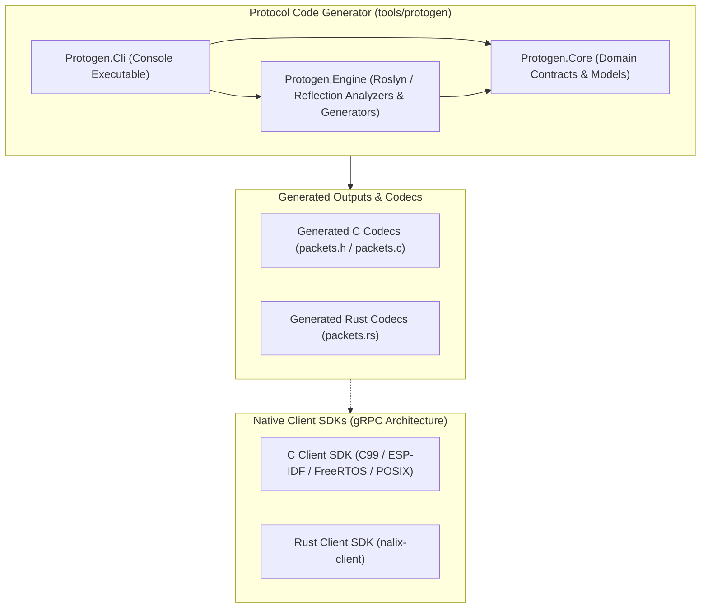

# Nalix Native Architecture Specification

## 1. System Overview

Nalix Native is a unified cross-platform native SDK and tooling repository designed for the Nalix binary messaging protocol.

The repository is partitioned into two primary functional components:
1. **Client SDKs (`clients/`):** Canonical, zero-dependency C99 and Rust client runtime architectures adhering to standard gRPC principles (Status codes, Wire framing, Channel connectivity states, Client lifecycle).
2. **Protocol Generator (`tools/protogen/`):** A Domain-Driven Design (DDD) utility partitioned into decoupled assemblies adhering to SOLID principles for analyzing C# contracts and generating wire-compatible C and Rust data models.



---

## 2. Client SDK Architecture (gRPC Standards)

The client runtime libraries (`clients/c/` and `clients/rust/`) adopt canonical gRPC patterns tailored for high-throughput, low-overhead binary messaging:

### 2.1 Canonical Status Codes
Error handling strictly maps to the 17 standard gRPC status codes:
- `0: OK`
- `1: CANCELLED`
- `2: UNKNOWN`
- `3: INVALID_ARGUMENT`
- `4: DEADLINE_EXCEEDED`
- `5: NOT_FOUND`
- `6: ALREADY_EXISTS`
- `7: PERMISSION_DENIED`
- `8: RESOURCE_EXHAUSTED`
- `9: FAILED_PRECONDITION`
- `10: ABORTED`
- `11: OUT_OF_RANGE`
- `12: UNIMPLEMENTED`
- `13: INTERNAL`
- `14: UNAVAILABLE`
- `15: DATA_LOSS`
- `16: UNAUTHENTICATED`

### 2.2 Nalix v14 Wire Framing
Every packet consists of a 6-byte Little-Endian binary header followed by an arbitrary payload:
- `OpCode` (2 bytes, uint16)
- `Flags` (1 byte, uint8)
- `Priority` (1 byte, uint8)
- `SequenceId` (2 bytes, uint16)

### 2.3 Channel Connectivity State Machine
Channels transition through deterministic states matching the gRPC channel lifecycle:
- `IDLE`: Initial state before establishing connection or after prolonged inactivity.
- `CONNECTING`: Attempting transport connection / handshake.
- `READY`: Connection established and available for packet exchange.
- `TRANSIENT_FAILURE`: Connection lost or failed handshake, attempting backoff reconnect.
- `SHUTDOWN`: Channel has been explicitly closed and destroyed.

---

## 3. Protogen Tooling Architecture

### 3.1 Domain Layer (`Protogen.Core`)

The domain layer encapsulates all business logic, invariant verification, and data models of the protocol representation. It has zero dependencies on external NuGet packages or Roslyn compiler libraries.

- **Models:**
  - `PacketSchema`: Immutable representation of a packet definition, including its 16-bit OpCode, field definitions, and wire size calculations.
  - `FieldSchema`: Value object defining individual packet field properties (data types, serialization order, size in bytes, nullability).
  - `GeneratedFile`: Encapsulates an emitted source file, relative destination path, and file contents.
- **Contracts:**
  - `IContractAnalyzer`: Abstraction for parsing packet contracts from source trees or binaries.
  - `ICodeGenerator`: Abstraction for rendering target language source code from an immutable list of `PacketSchema`.
- **Constants:**
  - `ProtocolConstants`: Defines fundamental wire protocol characteristics, such as the 6-byte header size and primitive type byte counts.
  - `ContractMetadata`: String identifiers for contract attributes (`[NalixPacket]`, `[Packet]`, `[SerializeOrder]`, `[SerializeHeader]`).

### 3.2 Infrastructure & Engine Layer (`Protogen.Engine`)

The engine layer implements domain contracts for analysis and code generation.

- **Analysis Implementations:**
  - `RoslynProjectAnalyzer`: Loads `.csproj` projects via MSBuild workspaces, compiles syntax trees, queries semantic models, and extracts field metadata without executing target code.
  - `ReflectionAssemblyAnalyzer`: Inspects compiled `.dll` assemblies via reflection, querying custom attribute providers and field offsets.
  - `TypeResolver`: Maps C# types (primitives, enums, byte buffers, strings) to unmanaged C types and Rust types.
  - `OpCodeEvaluator`: Evaluates compile-time constant expressions for `StaticOpCode`.
- **Generation Implementations:**
  - `CGenerator`: Emits C99 headers (`packets.h`), implementations (`packets.c`), and unit test runners (`packet_test.c`).
  - `RustGenerator`: Emits safe Rust modules (`packets.rs`) and round-trip unit test modules (`packets_tests.rs`).

### 3.3 Presentation Layer (`Protogen.Cli`)

The CLI layer is responsible for argument parsing, execution orchestration, and process return codes:
- Parses command-line arguments.
- Instantiates the chosen `IContractAnalyzer`.
- Coordinates target `ICodeGenerator` instances and writes generated files to disk.

---

## 4. SOLID Design Adherence

### 4.1 Single Responsibility Principle (SRP)
- `IContractAnalyzer` implementations only extract metadata into domain models.
- `ICodeGenerator` implementations only transform domain models into target language source strings.
- `Protogen.Cli` only manages process input, output, and process return codes.

### 4.2 Open/Closed Principle (OCP)
The code generation pipeline is open for extension but closed for modification. Adding a new target language (e.g., Go, Python, Swift) requires implementing `ICodeGenerator` without modifying existing analyzers or CLI execution flow.

### 4.3 Liskov Substitution Principle (LSP)
Both `RoslynProjectAnalyzer` and `ReflectionAssemblyAnalyzer` implement `IContractAnalyzer`. They are fully interchangeable and yield identical `PacketSchema` representations from identical contract definitions.

### 4.4 Interface Segregation Principle (ISP)
Interfaces are narrowly defined:
- `IContractAnalyzer`: Single asynchronous method `AnalyzeAsync(string targetPath, CancellationToken ct)`.
- `ICodeGenerator`: Single method `Generate(IReadOnlyList<PacketSchema> packets)`.

### 4.5 Dependency Inversion Principle (DIP)
High-level modules (the CLI runner) and low-level modules (the generators and analyzers) depend entirely on abstractions defined in `Protogen.Core`, ensuring zero cyclic dependencies and clean testability.

---

## 5. Architecture & Implementation Decisions

### 5.1 Decoupling from Nalix Packages
Protogen does not reference `Nalix.Codec` or `Nalix.Abstractions` directly. Contract analysis relies on string metadata matching defined in `ContractMetadata`. This ensures the code generator remains functional across Nalix major versions without assembly binding redirects or package lock conflicts.

### 5.2 Microcontroller-Safe Sequential Shift Decoding
Many embedded processors (including Xtensa cores on ESP32, RISC-V cores on ESP32-C3, and ARM Cortex-M0) trigger hardware exceptions on unaligned multi-byte memory access (e.g., `*(uint16_t*)ptr`).

To prevent memory alignment faults:
- Serialization uses `memcpy` and explicit byte-order shifts.
- Deserialization reads bytes sequentially via bitwise shifts:
  ```c
  uint16_t val = (uint16_t)(ptr[0] | ((uint16_t)ptr[1] << 8));
  ```
This pattern is architecture-agnostic and guarantees determinism across all unaligned memory configurations.

### 5.3 Multi-Compiler Structure Packing
Different compiler toolchains employ distinct mechanisms to eliminate structure padding:
- GCC and Clang support `__attribute__((packed))` and `#pragma pack(push, 1)`.
- MSVC supports `#pragma pack(push, 1)`.

Protogen generates cross-compiler preprocessor directives:
```c
#if defined(_MSC_VER) || defined(__GNUC__) || defined(__clang__)
    #pragma pack(push, 1)
#endif

typedef struct {
    PacketHeader Header;
    uint16_t Reason;
    uint8_t Type;
} Control;

#if defined(_MSC_VER) || defined(__GNUC__) || defined(__clang__)
    #pragma pack(pop)
#endif
```

### 5.4 C++ Linkage Compatibility
To support compilation under C++ toolchains (such as Arduino IDE, ESP-IDF C++ components, or native C++ backends), the generated C header encloses all function declarations in an `extern "C"` linkage guard:
```c
#ifdef __cplusplus
extern "C" {
#endif

void control_init(Control* pkt);
size_t control_serialize(const Control* pkt, uint8_t* buf, size_t buf_size);
size_t control_deserialize(Control* pkt, const uint8_t* buf, size_t buf_size);

#ifdef __cplusplus
}
#endif
```
