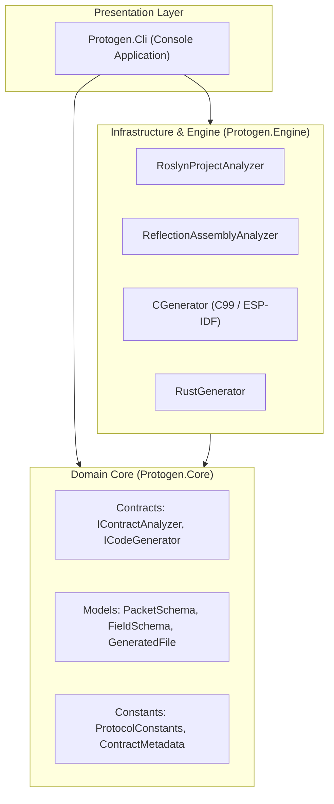
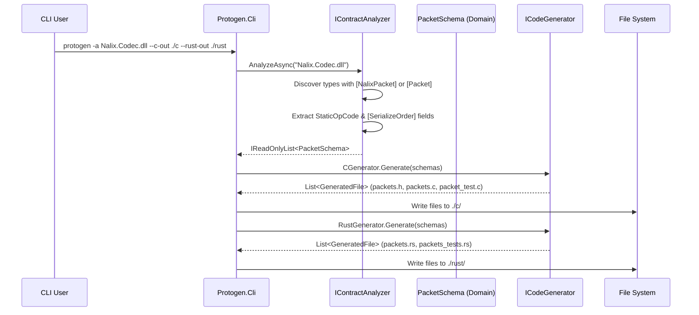

# Protogen Architecture Specification

This document details the internal architecture, design principles, compilation pipeline, and core engineering decisions behind **Protogen**.

---

## 1. Architectural Principles

Protogen is designed around **Domain-Driven Design (DDD)** and **SOLID** object-oriented principles:



### Clean Architecture Boundaries

1. **`Protogen.Core` (Domain Layer):**
   * Contains immutable domain entities and value objects: `PacketSchema`, `FieldSchema`, `GeneratedFile`.
   * Defines domain contracts: `IContractAnalyzer`, `ICodeGenerator`, `GenerationContext`.
   * Defines protocol invariants: `ProtocolConstants` (6-byte header size, opcode extraction rules) and `ContractMetadata`.
   * **Zero external dependencies**: Depends solely on standard .NET runtime abstractions.

2. **`Protogen.Engine` (Analysis & Generation Layer):**
   * Implements `IContractAnalyzer` using two distinct strategies:
     * `RoslynProjectAnalyzer`: Uses Microsoft Roslyn workspace compilation to inspect C# source code (`.csproj`) without executing target binaries.
     * `ReflectionAssemblyAnalyzer`: Uses reflection to load and inspect compiled assemblies (`.dll`).
   * Implements `ICodeGenerator` for target languages:
     * `CGenerator`: Produces C99 headers (`packets.h`), implementations (`packets.c`), and unit test runners (`packet_test.c`).
     * `RustGenerator`: Produces safe Rust modules (`packets.rs`) and test suites (`packets_tests.rs`).

3. **`Protogen.Cli` (Application & Presentation Layer):**
   * Single responsibility: parses command-line arguments, selects the appropriate analyzer strategy, passes domain schemas to active generators, and writes generated files to disk.

---

## 2. SOLID Adherence

| Principle | Implementation in Protogen |
| :--- | :--- |
| **Single Responsibility (SRP)** | Each analyzer only extracts metadata into `PacketSchema`. Each generator only transforms `PacketSchema` into source code strings. The CLI only coordinates I/O. |
| **Open/Closed (OCP)** | Adding a new target language (e.g. Go, Python, Swift, TypeScript) requires implementing `ICodeGenerator` without modifying existing analyzers or CLI code. |
| **Liskov Substitution (LSP)** | `RoslynProjectAnalyzer` and `ReflectionAssemblyAnalyzer` can be used interchangeably via `IContractAnalyzer` with identical output schema semantics. |
| **Interface Segregation (ISP)** | `IContractAnalyzer` and `ICodeGenerator` have narrow, focused contracts without unnecessary methods. |
| **Dependency Inversion (DIP)** | The CLI and Generators depend on domain abstractions (`IContractAnalyzer`, `ICodeGenerator`, `PacketSchema`) defined in `Protogen.Core`, never on concrete implementations. |

---

## 3. Compiler Pipeline



### Pipeline Execution Stages:
1. **Target Selection:** CLI validates CLI arguments and selects `RoslynProjectAnalyzer` (for `.csproj`) or `ReflectionAssemblyAnalyzer` (for `.dll`).
2. **Semantic Discovery:** The analyzer scans types decorated with `[NalixPacket]` or `[Packet]`, evaluates `StaticOpCode`, filters ignored properties (`[SerializeIgnore]`), and sorts fields according to `[SerializeHeader(n)]` and `[SerializeOrder(n)]`.
3. **Domain Normalization:** Injects the Nalix v14 6-byte `PacketHeader` at index `0` if the packet inherits `PacketBase<TSelf>`, calculates fixed wire sizes, and records variable-length traits.
4. **Code Generation:** Selected generators iterate through domain schemas and output idiomatic target source files.

---

## 4. Key Design Decisions

### A. Total Decoupling from Nalix Assemblies
Earlier prototypes referenced Nalix NuGet packages (`Nalix.Codec`, `Nalix.Abstractions`). This created brittle dependencies when Nalix versioned up.

**Protogen** operates completely standalone:
* Analyzers query attribute names via string metadata (`ContractMetadata.PacketAttributeNames`, `ContractMetadata.SerializeOrderNames`).
* OpCodes are discovered by evaluating the compile-time constant `StaticOpCode` or looking for interface `IPacketStaticOpcode`.
* Protogen contains **zero** `<ProjectReference>` or NuGet package dependencies to Nalix.

### B. Microcontroller-Safe Sequential Shift Decoding
Many embedded processors (such as ESP32 Xtensa cores, ESP32-C3 RISC-V, and ARM Cortex-M0/M3) panic or trigger hardware exceptions when performing unaligned 16-bit, 32-bit, or 64-bit memory accesses via pointer casting (`*((uint32_t*)ptr)`).

To guarantee 100% crash safety on embedded hardware:
* Serialization uses `memcpy` and explicit byte-order shifts.
* Deserialization reads bytes sequentially using bit shifts:
  ```c
  uint16_t val = (uint16_t)(ptr[0] | ((uint16_t)ptr[1] << 8));
  ```
* This pattern is guaranteed by the C standard to work on all CPU architectures, regardless of hardware alignment constraints.

### C. Multi-Compiler Memory Packing
Different C compilers use different directives for structure alignment packing:
* MSVC uses `#pragma pack(push, 1) ... #pragma pack(pop)`
* GCC and Clang use `__attribute__((packed))` or `#pragma pack(push, 1)`

Protogen emits cross-compiler preprocessor guards to ensure structures are tightly packed without padding bytes on all toolchains:
```c
#if defined(_MSC_VER)
    #pragma pack(push, 1)
#elif defined(__GNUC__) || defined(__clang__)
    #pragma pack(push, 1)
#endif

typedef struct {
    PacketHeader header;
    uint16_t reason;
    uint8_t type;
} Control;

#if defined(_MSC_VER) || defined(__GNUC__) || defined(__clang__)
    #pragma pack(pop)
#endif
```
