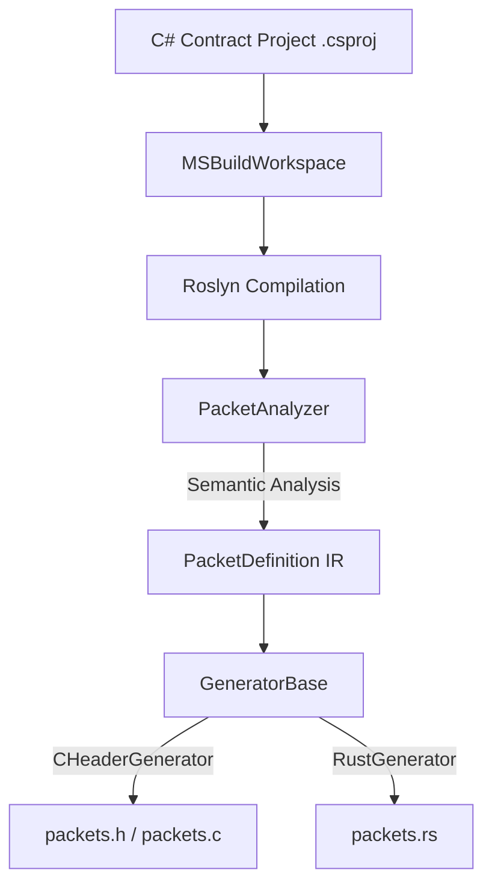

# Nalix Protogen Architecture Specification

This document details the internal architecture, compiler pipeline, and core design decisions of **Nalix.Protogen**.

---

## 1. Pipeline Overview

**Nalix.Protogen** uses Microsoft Roslyn and MSBuild workspace APIs to analyze C# contract source files, compile them semantically, and generate native, zero-dependency C and Rust memory structures that are byte-for-byte wire compatible.

The pipeline consists of three main phases:
1. **Semantic Parsing:** Building a Roslyn syntax/semantic compilation of the C# contract project.
2. **Intermediate Representation (IR):** Extraction of type characteristics and layout rules into a language-neutral IR.
3. **Generation:** Writing the structures, serialization, deserialization, equality, and validation routines in C and Rust.

---

## 2. Component Breakdown

The codebase is organized into three clean, single-responsibility assemblies:

### 💼 `Nalix.Protogen.Abstractions`
Defines the language-agnostic Intermediate Representation (IR):
* **`PacketDefinition`**: Stores the metadata of a packet, including name, full namespace, FNV-1a magic hash, fields, fixed-size status, and wire size.
* **`PacketField`**: Stores properties of a single field (name, order, size in bytes, C type name, Rust type name, and whether it represents a header field).
* **`GenerationContext`**: Captures execution parameters (paths, verbosity, output folders) passed from the CLI.

### ⚙️ `Nalix.Protogen.Roslyn`
The core parser and code generation engine:
* **`PacketAnalyzer`**: Opens the target `.csproj` or loads a `.dll` assembly, parses the syntax trees, and queries the semantic model. It filters out non-packet types and builds the list of `PacketDefinition` models.
* **`GeneratorBase`**: Coordinates the generation. It calculates base wire sizes and iterates over packets.
* **`CHeaderGenerator`**: Generates packed C structures (`#pragma pack(push, 1)`), endian-safe serialize/deserialize implementations, and helper functions (such as `xxx_free`).
* **`RustGenerator`**: Generates zero-copy Rust structures (`#[repr(C)]`), safe serialize/deserialize slice operations, and in-crate test suites.

### 💻 `Nalix.Protogen.Cli`
The console application interface. It handles argument parsing, configures the `GenerationContext`, runs the generators, and writes files to the target directories.

---

## 3. Key Design Decisions

### A. Implicit Header Insertion
In the C# Nalix framework, all packet classes inherit from `PacketBase<TSelf>`, which itself inherits from `FrameBase`. `FrameBase` contains a standard `PacketHeader` (6 bytes: `OpCode: 2B`, `Flags: 1B`, `Priority: 1B`, `SequenceId: 2B`). Consequently, C# packets have a header prepended on the wire automatically, without developers declaring it in each subclass.

Because C and Rust do not support class inheritance, they use flat structs. To guarantee wire layout alignment:
* `PacketAnalyzer` checks if a C# symbol inherits `PacketBase<TSelf>` (`InheritsPacketBaseOfSelf`).
* If true, it automatically inserts an implicit `Header` field of type `PacketHeader` at index `0` of the field list.
* This ensures C and Rust structs match C# byte alignment exactly.

### B. StaticOpCode Packet Identification
In Nalix v14, packets are identified by a 16-bit unsigned integer `OpCode` exposed via `IPacketStaticOpcode.StaticOpCode` on each packet type.

`PacketAnalyzer` extracts the `StaticOpCode` constant expression directly from the class AST (or via reflection when parsing `.dll` assemblies) and generates:
* C: `#define PACKET_<NAME>_OPCODE 0xXXXXU`
* Rust: `pub const OPCODE: u16 = 0xXXXX;`

An automatic init helper (`<packet>_init(&pkt)`) is emitted in C to initialize the struct and assign its header opcode automatically.

### C. Variable-Length Array & String Encoding
C# types like `string` and `ReadOnlyMemory<byte>` represent dynamic data and are mapped on the wire as length-prefixed formats:
* **Wire Format:** `[int32_t length][raw payload bytes]`
* A length of `-1` represents a C# `null`.
* A length of `0` represents an empty array/string.
* During serialization/deserialization, C code uses `NalixString` (which contains a pointer to a heap-allocated buffer) and Rust uses `Vec<u8>`. 
* The static size contribution of these fields is always `4` bytes (the length prefix itself).
