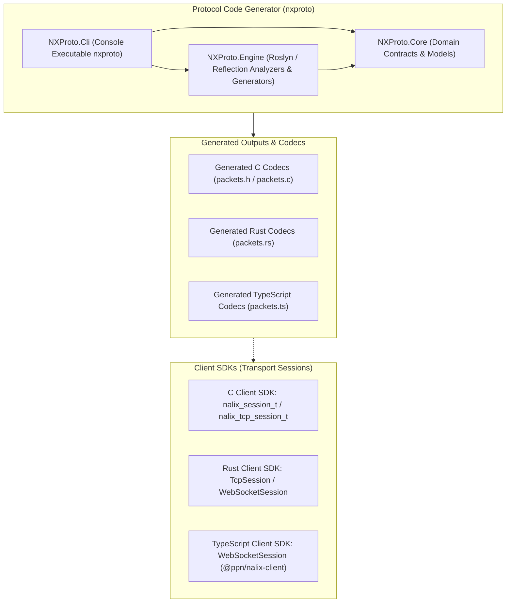
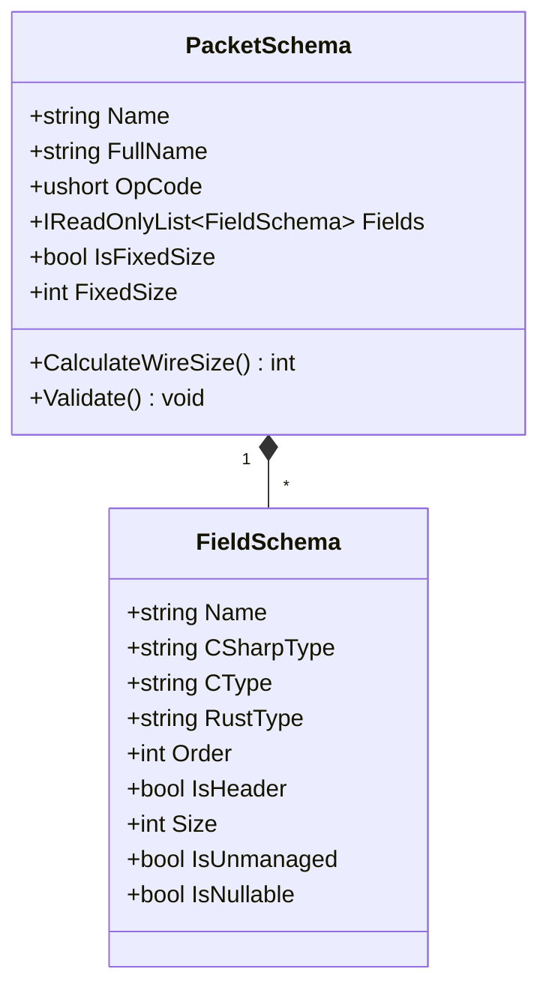
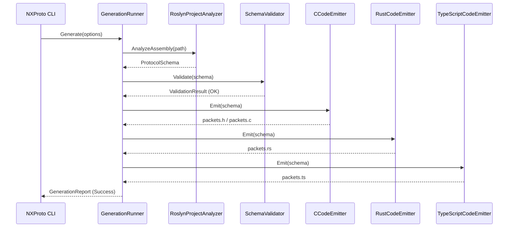

# Nalix Native Architecture Specification

## 1. System Overview

Nalix Native is a unified cross-platform native SDK and tooling repository designed for the Nalix binary messaging protocol.

The repository is partitioned into two primary functional components:
1. **Transport Sessions (`clients/`):** Canonical, zero-dependency C99, Rust, and TypeScript/Web transport sessions mirroring the Nalix C# SDK (`TransportSession`, `WebSocketSession`, `TcpSession`) with correlated requests, event subscriptions, status codes, and resilient connection lifecycles.
2. **Protocol Generator (`nxproto/`):** A Domain-Driven Design (DDD) utility partitioned into decoupled assemblies adhering to SOLID principles for analyzing C# contracts and generating wire-compatible C, Rust, and TypeScript data models.

---

## 2. Client SDK Architecture

The client runtime libraries (`clients/c/`, `clients/rust/`, and `clients/ts/`) adopt canonical session patterns identical to Nalix C# (`Nalix.SDK`):

### 2.1 Transport Sessions
- **TypeScript / Web (`clients/ts/`)**: Exposes `WebSocketSession` with browser WebSocket, correlated `session.request()`, opcode subscriptions `session.on()`, `session.ping()`, and auto-reconnect.
- **Rust (`clients/rust/`)**: Exposes `TcpSession` and `WebSocketSession` with synchronous/blocking framing, sequence tracking, and correlated requests.
- **C99 (`clients/c/`)**: Exposes `nalix_session_t` / `nalix_tcp_session_t` with raw buffer framing and non-blocking lifecycle.

### 2.2 Canonical Status Codes
Error handling strictly maps to 17 standard status codes:
- `0: OK`
- `1: CANCELLED`
- `2: UNKNOWN`
- `3: INVALID_ARGUMENT`
- `4: DEADLINE_EXCEEDED`
- `5: NOT_FOUND`
- `6: ALREADY_EXISTS`
- `7: PERMISSION_DENIED`
- `8: RESOURCE_EXHAUSTED`
- `9: FAILED_PRECONDITION`
- `10: ABORTED`
- `11: OUT_OF_RANGE`
- `12: UNIMPLEMENTED`
- `13: INTERNAL`
- `14: UNAVAILABLE`
- `15: DATA_LOSS`
- `16: UNAUTHENTICATED`

### 2.3 Wire Framing Contract
All frames share the Nalix v14 6-byte Little-Endian binary header:
- `OpCode`: 2 bytes (`uint16_t` / `u16`, Little-Endian)
- `Flags`: 1 byte (`uint8_t` / `u8`)
- `Priority`: 1 byte (`uint8_t` / `u8`)
- `SequenceId`: 2 bytes (`uint16_t` / `u16`, Little-Endian)
- `Payload`: Binary buffer (`length = TotalFrame - 6`)

### 2.4 Channel Connectivity State Machine
Channels transition through deterministic states matching the client connection lifecycle:
- `IDLE`: Initial state before establishing connection or after prolonged inactivity.
- `CONNECTING`: Attempting transport connection / handshake.
- `READY`: Connection established and available for packet exchange.
- `TRANSIENT_FAILURE`: Connection lost or failed handshake, attempting backoff reconnect.
- `SHUTDOWN`: Channel has been explicitly closed and destroyed.

### 2.5 Browser and Web Support (TypeScript SDK)
The TypeScript client runs directly within web browser runtimes without external polyfills or Node.js shims:
- Operates on native `window.WebSocket` and `ArrayBuffer` / `DataView`.
- Zero third-party dependencies at runtime.
- Emits ES modules (ESM) compatible with Next.js, Vite, Webpack, Node.js, Deno, and Bun.

---

## 3. NXProto Tooling Architecture

### 3.1 Domain Layer (`NXProto.Core`)

The domain layer encapsulates all business logic, invariant verification, and data models of the protocol representation. It has zero dependencies on external NuGet packages or Roslyn compiler libraries.

### 3.2 Engine Layer (`NXProto.Engine`)

The engine layer coordinates assembly loading, Roslyn semantic analysis, type resolution, validation, and multi-language code generation (C, Rust, TypeScript).

---

## 4. Cross-Platform Native Runtime Support

| Runtime / Platform | Language | Supported Transports | Header Framing | Zero-Copy |
| :--- | :--- | :--- | :--- | :--- |
| **Web Browsers (Modern)** | TypeScript | WebSocket (`wss://`) | Little-Endian | `ArrayBufferView` |
| **Node.js (22+) / Bun** | TypeScript | WebSocket (`wss://`) | Little-Endian | `Buffer` / `Uint8Array` |
| **Linux (x86_64 / ARM64)** | C99 / Rust | TCP, WebSocket | Little-Endian | Yes |
| **Windows (x86_64 / ARM64)** | C99 / Rust | TCP, WebSocket | Little-Endian | Yes |
| **ESP-IDF (ESP32-S3 / C3)** | C99 | TCP, LwIP Socket | Little-Endian | Yes |
| **FreeRTOS (STM32 / Cortex-M)** | C99 | TCP, FreeRTOS+TCP | Little-Endian | Yes |
| **Zephyr RTOS** | C99 | TCP, BSD Sockets | Little-Endian | Yes |
